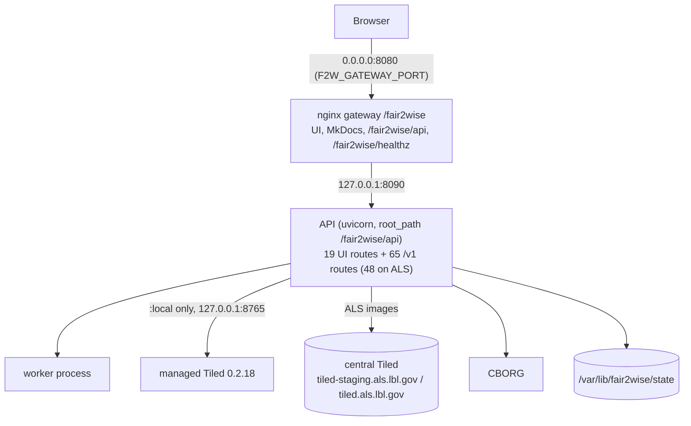

# Current architecture (forge_merge)

This page describes what the migration branch runs today. The pages that
describe the Splash Links stack, the `start_all.sh` launcher and the
`compose.splash.yaml` topology are **legacy**: they remain accurate for the
legacy editable mode and are marked as such. Sources of truth: the root
`README.md` ("Current architecture"), `docker/profiles/README.md` (images),
`docs/migration/api/README.md` (`/v1` API), `docs/migration/plan_addenda.md`
and `docs/migration/reviews/OPEN_DECISIONS.md` (owner decisions).

## Graph source: JSON KG by default

Versioned MatKG JSON files in `storage/kg/` are the graph the application
loads. Every supported launch path sets `KG_RAG_GRAPH_SOURCE=json` and
`F2W_KG_MODE=json`: `compose.yaml`, `scripts/start_agent_backend.sh`,
`scripts/start_rsoxs_stack.sh` and the three images. Only the bare
`app/modules/kg_rag_api.py` CLI still falls back to `config.yml`'s legacy
`splash` default; pass `--graph-source json`.

Tiled Graph is the experiment-identity source (live GraphQL) and the
publication target. Publishing an approved JSON snapshot into Tiled is a
separate job (`POST /v1/publications`, approval for the exact plan): extraction
never writes to Tiled as a side effect (H1-5). On `:local` the one allowed
target is the image's own Tiled (`app/api/local_publication.py`); every other
target and every ALS profile stays gated at H5. The walk-through is
[The `:local` image, end to end](local-image.md).

Splash (`splash_links/`, `F2W_KG_MODE=splash`) is deprecated (D03/D16) and is
kept only as the legacy editable mode until its approved retirement gate
(T16B/H7 or H8); the retirement packet is
`docs/migration/reviews/H8/splash_retirement.md` and nothing is deleted yet.
On `:local` the UI Save is wired lazily to the Tiled-backed target of the
active publication: before a first publication Save answers the typed 501 and
writes nothing, and the image starts in the editable mode (`--kg-mode splash`, backed by Tiled) so Save is available as soon as a publication exists (see
[Save on `:local`](local-image.md#save-on-local)). On a Tiled-only ALS
deployment Save still fails safely with the legacy 502 (T18C F1); the broader
edit design is pending owner decision (OPEN_DECISIONS A4; Q1-Q16 of
`docs/migration/ui_contracts/tiled_graph_editing_plan.md`).

## Three images, one gateway

| Image | Tiled | Access | Notes |
|---|---|---|---|
| `:local` | bundled managed server, Tiled **0.2.18** (owner exception O-T1 to the plan's 0.2.19 pin), data in `/var/lib/fair2wise/tiled` | trusted local operator, no sign-in (D34) | `F2W_LOCAL_BIND=network` allowed with a warning |
| `:als-dev` | none; `https://tiled-staging.als.lbl.gov` | Tiled sign-in; admins only for privileged work (D30) | `F2W_CORS_ORIGINS` required |
| `:als-prod` | none; `https://tiled.als.lbl.gov` | as `:als-dev` | `F2W_CORS_ORIGINS` required |

All three run the same supervisor (`docker/entrypoint/f2w_supervisor.py` under
tini): preflight, `tiled` (`:local` only), `api`, `worker`, `gateway`. The
gateway is the only ingress; it listens on `F2W_GATEWAY_PORT` (default
**8080**) and serves everything under **`/fair2wise`** (`/fair2wise/`,
`/fair2wise/api/`, `/fair2wise/docs/`, `/fair2wise/healthz`). The API binds
`127.0.0.1:8090` inside the container and is not published. The profile
(`docker/profiles/*.json`) fixes the deployment variables; a conflicting
environment exits 78 before any process starts. Build, check and run commands
are in `docker/profiles/README.md`; the ALS edge proxy requirement (overwrite
`X-Forwarded-Proto`) is OPEN_DECISIONS C8.

The legacy `agent` Dockerfile target (API only, root, no supervisor, Splash
tooling) is used by `compose.yaml` and `compose.splash.yaml` and is not one
of the three images.

## Runtime selection

| Variable | Default | Meaning |
|---|---|---|
| `F2W_RUNTIME` | `legacy` | `legacy` keeps the existing F2W read path; `langgraph` enables the scoped LangGraph runtime (T02) |
| `F2W_QA_ROUTE` | `supervisor` | In `langgraph` mode: `supervisor` routes UI QA turns through the planning supervisor (T03B, owner H2 Q1); `direct` calls `answer_from_knowledge` directly. A planner failure falls back to the direct call (O-R1) |
| `F2W_DEPLOYMENT_PROFILE` | `local` | `local`, `als-dev` or `als-prod`; fixed by the image profile |

Any other value is a startup error (`config_rejected`).

## APIs

- `python -m app.modules.f2w_agent.cli api` serves the 19 frozen UI routes
  (`create_app`, D11).
- `python -m app.modules.f2w_agent.cli api --jobs-api` serves
  `app.api.main.create_api_app`: the same UI routes plus the 65 `/v1` routes (48 on an ALS profile: the
  folder and library routes are `:local` only) for jobs, review, publication,
  status, validation, operations, capabilities and graph sources, the origin
  gate and the body cap. The images run this factory. Route policies and the service
  contract are in `docs/migration/api/README.md`.
- `python -m app.api.cli --root DIR jobs|cases|audit|ops ...` is the operations
  CLI (local profile only).
- The legacy model-compatible API (`kg_rag_api.py --api`, port 11435) is
  loopback-bound and projected since T28A; it is not exposed under
  `/fair2wise` on ALS.

## Validation judge model

The binary evaluation suite is separate validation, never part of a chat turn
(H3 B). Its judge model is a deployment-wide setting chosen in the settings
panel from the provider's live model list (`GET/PUT /v1/validation/judge-model`,
owner O-U2); each report records the judge used. Only free LBL-hosted CBORG
models are offered or accepted (owner decision 2026-11-09, `app/modules/model_policy.py`;
see [Model policy](configuration.md#model-policy-free-cborg-models-only)).

## Pending owner decisions that affect operation

- Tiled graph editing on ALS (OPEN_DECISIONS A4) and the Splash retirement gate.

Decided, for reference: publication approvals never expire on `:local` and
expire after 24 h on ALS (owner O-T2; `default_approval_ttl` in
`app/api/operations.py`).
- Image publishing tag rules (OPEN_DECISIONS D2) and paper snippets in images
  (D3.1).
