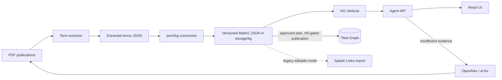

# FAIR2WISE

FAIR2WISE turns materials-science publications into a provenance-aware
knowledge graph and uses that graph to answer questions, identify missing
evidence, retrieve papers, and expand the graph.

This site documents the maintained codebase: the React application, agent API,
`/v1` jobs API, orchestrated evidence workflow, extraction pipeline, KG
conversion and retrieval, the three deployment images, operational scripts,
tests, and legacy compatibility modules (including the legacy Splash Links
graph service).

!!! note "Read first"

    [Current architecture](current-architecture.md) describes what the
    `forge_merge` branch runs today: JSON KG by default, three images
    (`:local` with Tiled 0.2.18, `:als-dev`/`:als-prod` with central Tiled),
    one gateway on port 8080 under `/fair2wise`. Pages about Splash Links and
    the `start_all.sh` launcher describe the **legacy** editable mode.

## What runs

| Service | Default address | Implementation | Purpose |
|---|---:|---|---|
| Gateway (images) | `http://127.0.0.1:8080/fair2wise/` (`F2W_GATEWAY_PORT`) | `docker/nginx.conf`, supervisor | Single ingress: UI, MkDocs under `/fair2wise/docs/`, same-origin `/fair2wise/api` |
| [Web UI](frontend.md) | under the gateway; Compose dev stack `http://127.0.0.1:5175/fair2wise/`; `5173` CORS-allowed | `ui/` | Chat, graph exploration/editing, publication search, settings |
| Agent API | `127.0.0.1:8090` (inside the images, not published; published by the Compose dev stack) | `app/modules/f2w_agent/api.py`, `app/api/main.py` (`--jobs-api`) | Sessions, orchestration, KG reads/edits, streaming chat; `/v1` jobs, review, publication |
| Tiled | `:local` managed server `127.0.0.1:8765` (Tiled 0.2.18); ALS central servers | `app/modules/graph/`, `docker/entrypoint/` | Experiment identity, gated publication target |
| Splash Links (**legacy**) | local `:8081` with `compose.splash.yaml` or `start_all.sh` | `splash_links/` | Legacy editable graph store |

`docker/profiles/README.md` has the image commands. For development from
source, `./scripts/start_rsoxs_stack.sh` daemonizes the JSON-KG agent+UI
(ports 5175/8090) and `docker compose up` starts agent + gateway with the JSON
KG. **Legacy:** `./scripts/start_all.sh` starts Splash, agent, and UI together.
**Never bind host 5174.**

## End-to-end data flow

## Main concepts

- **Term extraction** processes PDF pages through an LLM, validates terms
  against the LinkML schema, merges duplicate records, and attaches
  publication and source-code provenance.
- **MatKG JSON** is the portable graph format: `things` are nodes and
  `associations` are directed edges.
- **Tiled Graph** is the experiment-identity source and the gated publication
  target. **Splash Links** (legacy) stores editable graph records and remains
  only until its retirement gate.
- **KG-RAG retrieval** supports lexical or SentenceTransformer/FAISS search,
  graph expansion, evidence-aware ranking, and bounded context assembly.
- **The workflow orchestrator** decides whether to answer from the KG, search
  for candidate publications, request download or extraction approval, query
  an active paper, or report extracted terms.
- **Sessions** isolate chat memory, workflow state, pending approvals, and
  session graph files.

## Documentation paths

- Start with [Getting started](getting-started.md).
- Follow [Fresh-machine deployment](deployment.md) for `.env`, CBORG/IPv6,
  first start, upgrades, and rollback.
- Use the [end-to-end tutorials](tutorials.md) to move from a grounded question
  through approved extraction and graph inspection.
- Read [Current architecture](current-architecture.md) and then
  [System architecture](architecture.md) (legacy stack) before changing
  service boundaries.
- Read [Data provenance](provenance.md) before merging corpora or relying on
  citations, and [Security model](security.md) before exposing the application.
- Use [Repository reference](repository-reference.md) to locate ownership for a
  feature.
- Follow the [Contributor guide](contributing.md) for branches, dependency
  locks, validation, and extension points.
- Use [Release and maintenance](release.md) for versioning, publishing,
  upgrades, and database compatibility, and [Performance](performance.md) for
  graph, retrieval, context, UI, worker, and cache tuning.
- Consult [Agent API](agent-api.md), the legacy [Splash Links](splash-links.md)
  page, and the [GraphQL cookbook](graphql-cookbook.md) when changing
  client/server contracts or validating an extracted graph.
- Follow [Testing](testing.md) before submitting changes.

!!! note "Source of truth"

    The documentation describes the checked-in implementation. Configuration
    values can be overridden by CLI arguments and environment variables; see
    [Configuration](configuration.md).
